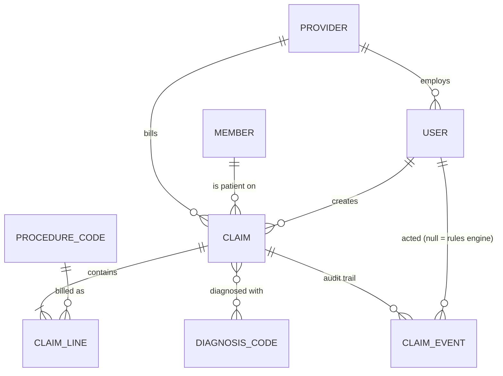
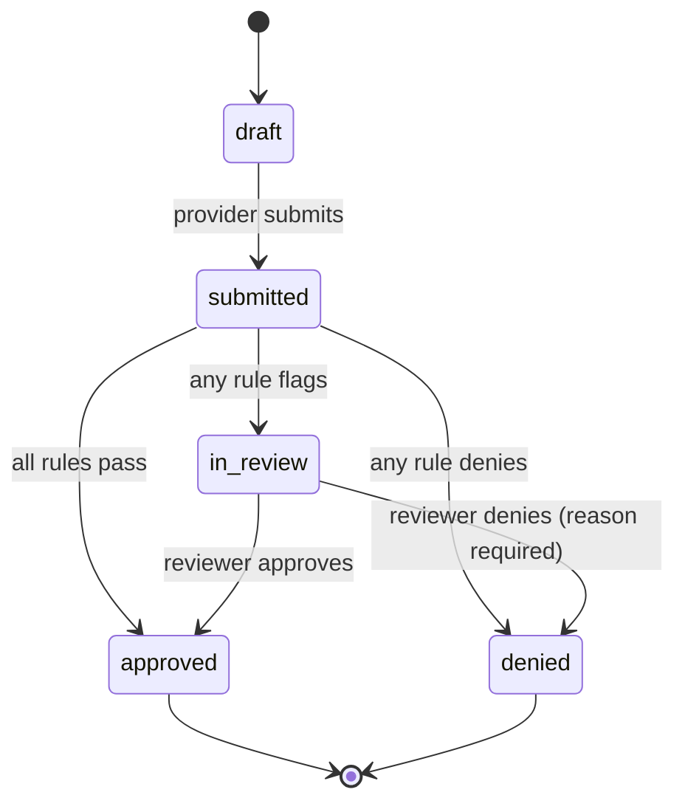

# ClaimFlow

A healthcare **claims management system** built with Django and Django REST Framework.

Clinic staff submit insurance claims with ICD-10 diagnosis codes and CPT procedure codes. A rules engine automatically approves the claim, denies it, or sends it to a human reviewer, who makes the final decision. Every step is recorded in an append-only audit trail.

  

## Features

- **Claim lifecycle as a state machine:** `draft → submitted → (in_review) → approved | denied`. Illegal transitions are rejected in one place.
- **Auto-adjudication rules engine:** eligibility, timely filing, duplicate detection, high-cost review, procedures that need review, and unit limits. Each rule is a small class (Strategy pattern), so adding a rule means adding one class.
- **Pricing:** allowed amount = `min(billed, fee schedule × units)` per line.
- **Role-based and row-level access control:** provider staff see only their own organisation's claims, reviewers see everything except drafts, and nobody can decide a claim they created.
- **Append-only audit trail:** who did what and when, plus the result of every rule.
- **Health data (PHI) handling:** member IDs are masked in lists, staff look patients up by member ID instead of browsing a list, and sessions time out after 30 minutes.
- **REST API:** token or session auth, pagination, filtering and validation, with `409 Conflict` for invalid state changes.
- **Dashboard:** status counts, approval rate, auto-decision rate and the review queue, computed in a single aggregate query.
- **Production setup:** PostgreSQL, Docker Compose, gunicorn, WhiteNoise, environment-based settings and a GitHub Actions CI pipeline.

## Architecture

```
Browser (Django templates) ─┐
                            ├─> views.py / api.py ──> services.py ──> rules.py (engine)
REST client (DRF, token) ───┘          (thin)        (business logic,      │
                                                      transactions,        ▼
                                                      permissions)      models.py ──> PostgreSQL / SQLite
```

Views and API endpoints stay thin. All business logic, including permissions, state transitions, row locking and audit events, lives in `claims/services.py`, so the web UI and the API behave identically.

### Data model



### Claim states



## Run it locally

```bash
python3 -m venv .venv && source .venv/bin/activate
pip install -r requirements.txt
python manage.py migrate
python manage.py seed_demo          # demo data: about 30 claims, 4 users
python manage.py runserver
```

Open http://127.0.0.1:8000. All demo accounts use the password `claimflow-demo`:

| Username | Role | Sees |
|---|---|---|
| `clinic_staff` | Provider staff, Sunrise Family Clinic | Own clinic's claims; can create and submit |
| `ortho_staff` | Provider staff, Lakeside Orthopedics | Own clinic's claims only |
| `reviewer` | Claims reviewer | All submitted claims; decides the review queue |
| `admin` | Administrator | Everything, plus Django admin at `/admin/` |

### With Docker and PostgreSQL

```bash
docker compose up --build
docker compose exec web python manage.py seed_demo
```

### Tests

```bash
python manage.py test
```

There are 42 tests covering the rules, pricing, state machine, permissions, audit log immutability, web forms and the REST API.

## API

```bash
# Get a token
curl -X POST -d "username=clinic_staff&password=claimflow-demo" http://localhost:8000/api/token/

# Create a draft
curl -X POST http://localhost:8000/api/claims/ \
  -H "Authorization: Token <token>" -H "Content-Type: application/json" \
  -d '{"member_id": "M100201", "service_date": "2026-10-01", "diagnoses": ["I10"],
       "lines": [{"procedure": "99213", "units": 1, "billed_amount": "120.00"}]}'

# Submit it (runs the rules engine)
curl -X POST -H "Authorization: Token <token>" http://localhost:8000/api/claims/<claim_number>/submit/

# Reviewer decision
curl -X POST -H "Authorization: Token <reviewer-token>" -H "Content-Type: application/json" \
  -d '{"approve": false, "reason": "No prior authorisation on file."}' \
  http://localhost:8000/api/claims/<claim_number>/decide/
```

| Method | Endpoint | Purpose |
|---|---|---|
| GET | `/api/claims/?status=in_review` | List visible claims (paginated) |
| POST | `/api/claims/` | Create a draft with lines |
| GET | `/api/claims/{claim_number}/` | Detail, including the audit trail |
| POST | `/api/claims/{claim_number}/submit/` | Submit and auto-adjudicate |
| POST | `/api/claims/{claim_number}/decide/` | Reviewer decision |
| GET | `/api/procedures/`, `/api/diagnoses/` | Reference codes |

## Project layout

```
accounts/         Custom User (role) and Provider models
claims/
  models.py       Member, codes, Claim, ClaimLine, ClaimEvent (+ constraints, indexes)
  rules.py        Rule base class, six rules, AdjudicationEngine
  services.py     Lifecycle, permissions, pricing, transactions
  views.py        Server-rendered pages
  api.py          DRF serializers and viewsets
  forms.py        Claim form + inline formset for service lines
  management/commands/seed_demo.py
  tests/          Rules, workflow, web and API tests
config/           Settings (env-driven), URLs
```

## Limitations and next steps

- Codes and fee amounts are a small illustrative sample, not a licensed code set or a real fee schedule.
- The PHI handling demonstrates the ideas; it is not a full HIPAA compliance programme. Real systems would add encryption at rest, access logging for reads, MFA and data retention policies.
- Possible next steps: a Celery queue for batch adjudication, an EDI 837/835 import and export, FHIR `Claim` resources, rule configuration from the database, and analytics on denial reasons.
